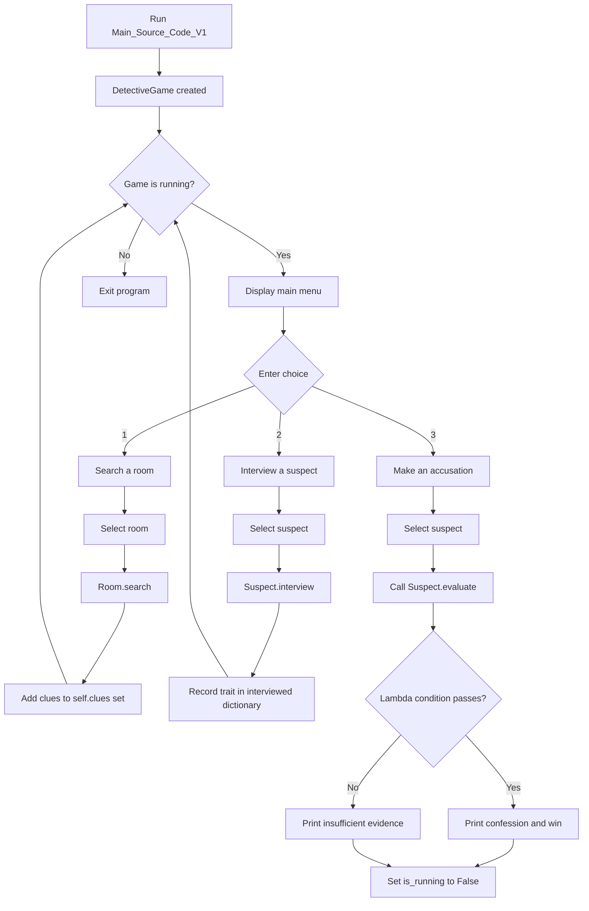
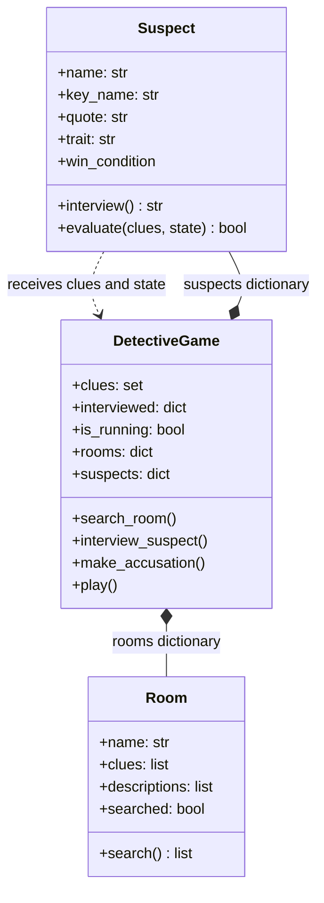
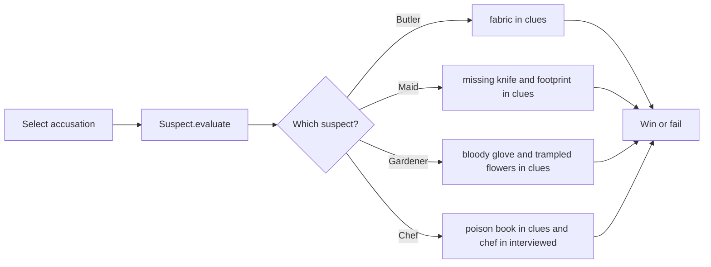
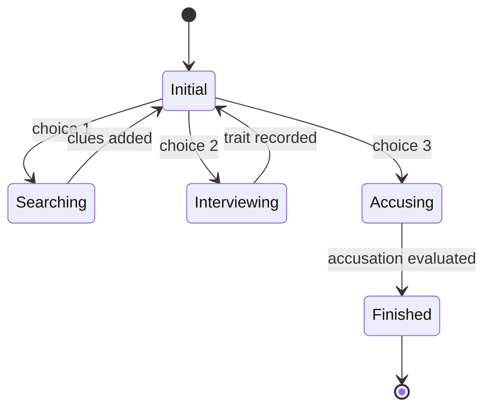

# Golden Arcs

A text-based detective mystery game written in Python. Investigate five rooms, collect clues, interview suspects, and make an accusation by satisfying one suspect's evidence condition.

> The complete executable source is stored in [`Main_Source_Code_V1`](Main_Source_Code_V1). It is a Python file even though it has no `.py` extension.

## Features

- Five searchable rooms with room-specific clues and descriptions
- Set-based clue collection that automatically prevents duplicate evidence
- Four suspects with statements and stored traits
- Lambda-based accusation rules
- Stateful interview tracking
- A menu loop driven by a function-dispatch dictionary
- Searched-room indicators
- No third-party dependencies

## User manual

### Requirements

- Python 3.8 or newer
- A terminal or command prompt
- No additional Python packages

### Installation

1. Download or clone the repository:

```bash
git clone https://github.com/shivangichaudhary-cse/Golden-Arcs.git
cd Golden-Arcs
```

2. Confirm that Python is available:

```bash
python --version
```

On older macOS/Linux setups, use `python3` if necessary:

```bash
python3 Main_Source_Code_V1
```

On Windows, `py` may be available:

```bash
py --version
py Main_Source_Code_V1
```

### Starting the game

Run this command from the repository directory:

```bash
python Main_Source_Code_V1
```

Example startup output:

```text
Welcome to 'Golden arches'!

--------------------------------
1. Search a room
2. Interview a suspect
3. Make an accusation
Enter choice (1-3):
```

### Main menu options

| Option | Action |
|---|---|
| `1` | Opens the room list and adds a room's clues to the evidence set |
| `2` | Opens the suspect list and records the selected suspect's trait |
| `3` | Opens the accusation list and immediately ends the game after evaluation |

Enter only the menu number. The program trims surrounding spaces, but it does not accept names or extra text in place of numbers.

### Search a room

1. Enter `1` at the main menu.
2. Enter a number from `1` to `5`.
3. Read the room descriptions and their clues.

Example:

```text
Enter choice (1-3): 1

Which room would you like to search?
1. The Study
2. The Library
3. The Kitchen
4. The Garden
5. The Bedroom
Choice: 4

You search The Garden and find:
- A buried bloody glove.
- Trampled flowers.
```

Afterward, the game returns to the main menu. The Garden is marked `[Searched]` in later room lists.

A room can be searched more than once. Its clues are added to a Python set, so repeated searches do not add duplicates.

### Interview a suspect

1. Enter `2` at the main menu.
2. Enter a suspect number from `1` to `4`.
3. Read the suspect's quote.

Example:

```text
Enter choice (1-3): 2

Which suspect would you like to interview?
1. The Butler
2. The Maid
3. The Gardener
4. The Chef
Choice: 4

You interview The Chef. They say:
'I was with the maid in the kitchen!'
```

The Chef interview stores `chef` in the internal interviewed dictionary with the trait `alibi for maid`. Interviews do not themselves prove guilt; they must be combined with the accusation condition where applicable.

### Make an accusation

1. Enter `3` at the main menu.
2. Enter a suspect number from `1` to `4`.

The accusation is checked immediately against that suspect's condition. The game then prints either a confession or insufficient-evidence message and exits.

Example of a successful accusation:

```text
Enter choice (1-3): 3

Who do you accuse?
1. The Butler
2. The Maid
3. The Gardener
4. The Chef
Choice: 1

You accuse The Butler. They confess! You solved the case! 🎉
```

Example of a failed accusation:

```text
Enter choice (1-3): 3

Who do you accuse?
1. The Butler
2. The Maid
3. The Gardener
4. The Chef
Choice: 3

You accuse The Gardener, but lack sufficient evidence. The culprit escapes! 🕵️‍♂️
```

### Restarting after an accusation

Run the command again:

```bash
python Main_Source_Code_V1
```

This creates a new `DetectiveGame` with an empty clue set and an empty interview dictionary.

## Worked example: solve the case

This example demonstrates a complete winning sequence for the Butler:

```text
$ python Main_Source_Code_V1
Welcome to 'Golden arches'!

Enter choice (1-3): 1
Choice: 5

You search The Bedroom and find:
- Torn fabric matching butler uniform.
- Debt documents.

Enter choice (1-3): 3
Choice: 1

You accuse The Butler. They confess! You solved the case! 🎉
```

The Bedroom adds `fabric` to `self.clues`. The Butler condition is `"fabric" in clues`, so the accusation succeeds. You do not need to interview the Butler for this route.

### Example: solve the Maid route

Search the Kitchen and accuse the Maid:

```text
Enter choice (1-3): 1
Choice: 3

You search The Kitchen and find:
- A missing kitchen knife.
- A footprint in flour.

Enter choice (1-3): 3
Choice: 2

You accuse The Maid. They confess! You solved the case! 🎉
```

The Maid requires both `missing knife` and `footprint`.

### Example: solve the Gardener route

Search the Garden and accuse the Gardener:

```text
Enter choice (1-3): 1
Choice: 4

You search The Garden and find:
- A buried bloody glove.
- Trampled flowers.

Enter choice (1-3): 3
Choice: 3

You accuse The Gardener. They confess! You solved the case! 🎉
```

The Gardener requires both `bloody glove` and `trampled flowers`.

### Example: solve the Chef route

Search the Library and interview the Chef:

```text
Enter choice (1-3): 1
Choice: 2

You search The Library and find:
- A hidden passage to the study.
- A book on poisons.

Enter choice (1-3): 2
Choice: 4

You interview The Chef. They say:
'I was with the maid in the kitchen!'

Enter choice (1-3): 3
Choice: 4

You accuse The Chef. They confess! You solved the case! 🎉
```

The Chef requires both `poison book` and a `chef` entry in the interviewed dictionary.

## Win conditions

| Suspect | Accusation condition |
|---|---|
| The Butler | `fabric` is present in the clues set |
| The Maid | `missing knife` and `footprint` are both present |
| The Gardener | `bloody glove` and `trampled flowers` are both present |
| The Chef | `poison book` is present and `chef` was interviewed |

## Input troubleshooting

### Invalid room choice

If you enter a room number outside `1`–`5`, the program prints:

```text
Invalid room choice.
```

No clues are changed. Choose `1` again to make another room selection.

### Invalid suspect choice

If you enter a suspect number outside `1`–`4` during an interview, the program prints:

```text
Invalid suspect choice.
```

No interview is recorded.

### Invalid accusation choice

If you enter a number outside `1`–`4` during an accusation, the program prints:

```text
Invalid choice.
```

The game remains running because `is_running` is only set to `False` after a valid suspect is selected.

### Invalid main-menu choice

If you enter anything except `1`, `2`, or `3`, the program prints:

```text
Invalid choice. Pick 1, 2, or 3.
```

The game remains running and displays the menu again.

## Game flow



## Source structure



## Rooms and clues

| Choice | Room | Clues found |
|---|---|---|
| 1 | The Study | `letter`, `vase`, `diary` |
| 2 | The Library | `hidden passage`, `poison book` |
| 3 | The Kitchen | `missing knife`, `footprint` |
| 4 | The Garden | `bloody glove`, `trampled flowers` |
| 5 | The Bedroom | `fabric`, `debts` |

Each room can be searched repeatedly. `Room.search()` sets `searched = True` and still returns the room's clues each time, while `DetectiveGame.clues` remains a set so duplicate clues are not added.

## Accusation conditions

Accusations succeed only when the selected suspect's lambda condition evaluates to `True`.



## Internal state



The game maintains these core state structures:

- `clues`: a set of discovered clue names
- `interviewed`: a dictionary mapping suspect keys to traits
- `is_running`: controls whether the main loop continues
- `rooms`: a dictionary mapping menu choices to `Room` objects
- `suspects`: a dictionary mapping menu choices to `Suspect` objects

## Project files

| File | Purpose |
|---|---|
| [`Main_Source_Code_V1`](Main_Source_Code_V1) | Complete game implementation |
| [`README.md`](README.md) | Project documentation |
| [`LICENSE`](LICENSE) | MIT license |

## License

This project is licensed under the [MIT License](LICENSE).
