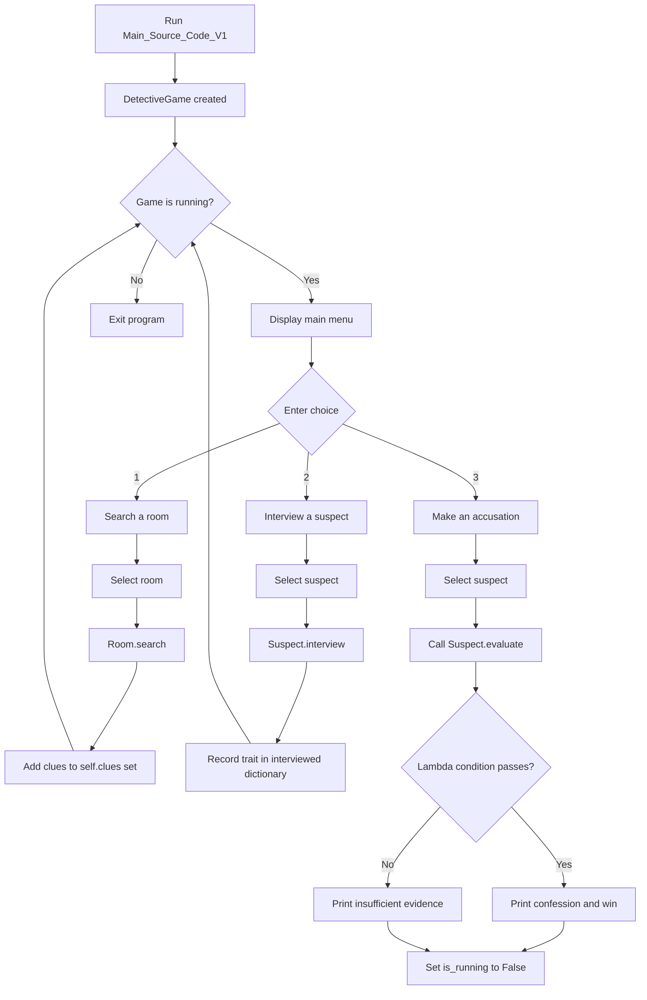
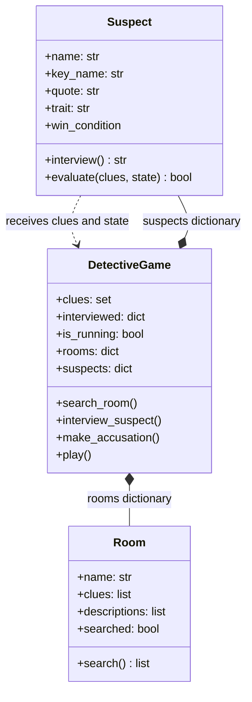
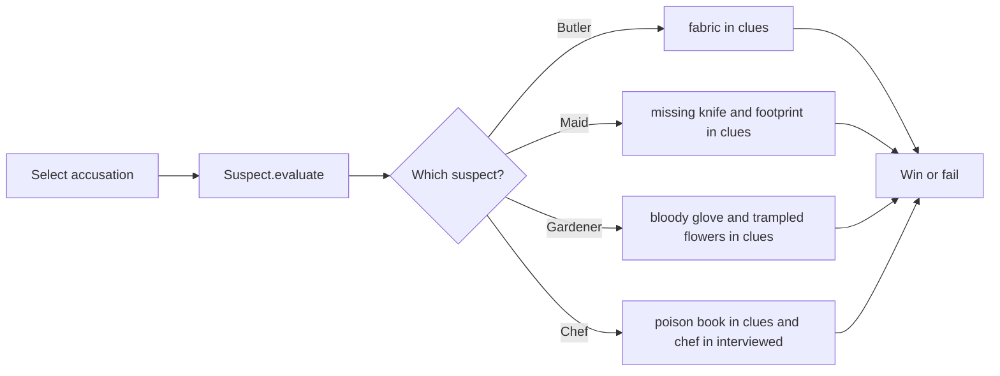
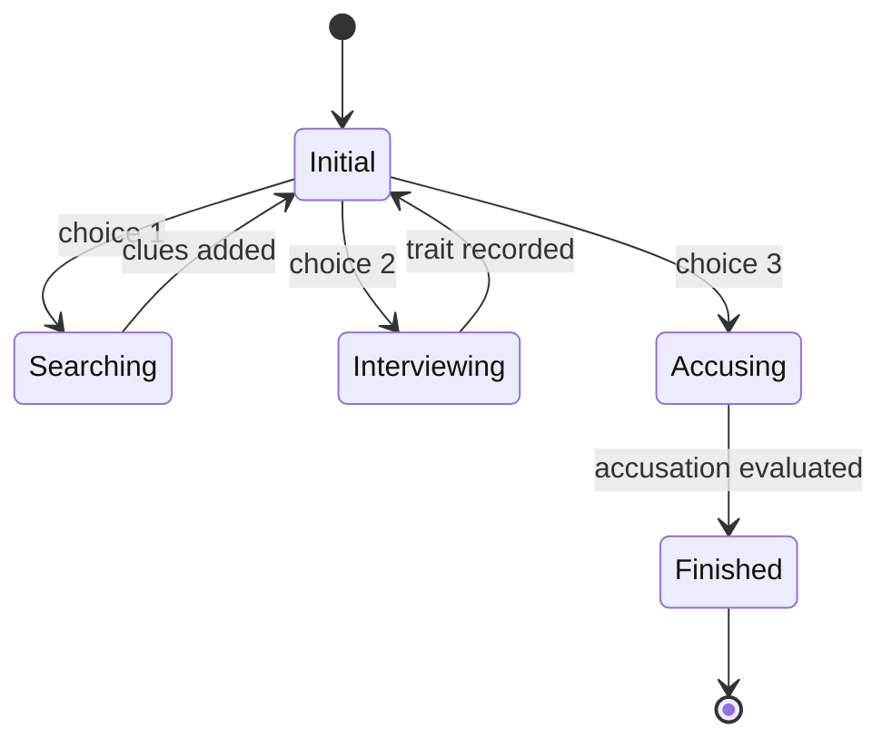

# Golden Arcs

A text-based detective mystery game written in Python. Investigate five rooms, collect clues, interview suspects, and make an accusation by satisfying one suspect's evidence condition.

> The complete executable source is stored in [`Main_Source_Code_V1`](Main_Source_Code_V1). It is a Python file even though it has no `.py` extension.

## Features

- Five searchable rooms with room-specific clues and descriptions
- Set-based clue collection that automatically prevents duplicate evidence
- Four suspects with statements and stored traits
- Lambda-based accusation rules
- Stateful interview tracking
- A menu loop driven by a function-dispatch dictionary
- Searched-room indicators
- No third-party dependencies

## Run the game

Python 3.8 or newer is required.

```bash
python Main_Source_Code_V1
```

On Windows, if `python` is unavailable, try:

```bash
py Main_Source_Code_V1
```

## How to play

1. Choose **Search a room** and enter a room number.
2. Read the descriptions and collect the room's clues.
3. Choose **Interview a suspect** to view a statement and record that suspect's trait.
4. Choose **Make an accusation** and select a suspect.
5. The game ends after the accusation, whether it succeeds or fails.

## Game flow



## Source structure



## Rooms and clues

| Choice | Room | Clues found |
|---|---|---|
| 1 | The Study | `letter`, `vase`, `diary` |
| 2 | The Library | `hidden passage`, `poison book` |
| 3 | The Kitchen | `missing knife`, `footprint` |
| 4 | The Garden | `bloody glove`, `trampled flowers` |
| 5 | The Bedroom | `fabric`, `debts` |

Each room can be searched repeatedly. `Room.search()` sets `searched = True` and still returns the room's clues each time, while `DetectiveGame.clues` remains a set so duplicate clues are not added.

## Accusation conditions

Accusations succeed only when the selected suspect's lambda condition evaluates to `True`.

| Suspect | Required evidence or state |
|---|---|
| The Butler | Clue `fabric` |
| The Maid | Clues `missing knife` and `footprint` |
| The Gardener | Clues `bloody glove` and `trampled flowers` |
| The Chef | Clue `poison book` and key `chef` in the interviewed state |

The Chef can be considered guilty by finding `poison book` and interviewing the Chef. Interviewing the Chef stores `alibi for maid` under the key `chef` in `self.interviewed`.



## Internal state



The game maintains these core state structures:

- `clues`: a set of discovered clue names
- `interviewed`: a dictionary mapping suspect keys to traits
- `is_running`: controls whether the main loop continues
- `rooms`: a dictionary mapping menu choices to `Room` objects
- `suspects`: a dictionary mapping menu choices to `Suspect` objects

## Project files

| File | Purpose |
|---|---|
| [`Main_Source_Code_V1`](Main_Source_Code_V1) | Complete game implementation |
| [`README.md`](README.md) | Project documentation |
| [`LICENSE`](LICENSE) | MIT license |

## License

This project is licensed under the [MIT License](LICENSE).
